# Investigation forensic disque Linux — Lab « Insider » (CyberDefenders)

> Rapport d'investigation numérique sur l'image disque de la machine d'une employée suspectée d'activités illégales au sein de la société fictive **TAAUSAI**.

| | |
|---|---|
| **Plateforme** | CyberDefenders (Blue Team Labs) |
| **Catégorie** | Endpoint Forensics / Disk Forensics (Linux) |
| **Preuve analysée** | `FirstHack.ad1` (image logique FTK Imager) |
| **Outils principaux** | FTK Imager, Kali Linux, `find`, `grep`, `cat`, `sha256sum`, Excel |
| **Résultat** | 11 questions sur 11 résolues |
| **Auteure** | ALI Assanatou — Licence Sécurité Informatique, IFRI (Université d'Abomey-Calavi) |

---

## Sommaire

1. [Résumé exécutif](#1-résumé-exécutif)
2. [Contexte et objectifs](#2-contexte-et-objectifs)
3. [Preuve et intégrité](#3-preuve-et-intégrité)
4. [Méthodologie et outils](#4-méthodologie-et-outils)
5. [Synthèse des résultats](#5-synthèse-des-résultats)
6. [Analyse détaillée](#6-analyse-détaillée)
7. [Chronologie reconstituée](#7-chronologie-reconstituée)
8. [Indicateurs de compromission et artefacts clés](#8-indicateurs-de-compromission-et-artefacts-clés)
9. [Correspondance MITRE ATT&CK](#9-correspondance-mitre-attck)
10. [Limites de l'analyse](#10-limites-de-lanalyse)
11. [Recommandations](#11-recommandations)
12. [Conclusion](#12-conclusion)
13. [Annexe : reproduire l'analyse](#13-annexe--reproduire-lanalyse)

---

## 1. Résumé exécutif

L'analyse de l'image du poste de Karen montre une machine **Kali Linux** (nom d'hôte `KarenHacker`) utilisée comme plateforme d'apprentissage et d'expérimentation offensive. Les éléments suivants ont été établis :

- l'outil de vol d'identifiants **Mimikatz** a été téléchargé (`mimikatz_trunk.zip`) puis déposé sur le Bureau ;
- **Metasploit** a été initialisé (`msfdb init`, démarrage de PostgreSQL) ;
- une **liste d'objectifs** révèle l'intention : *« Gain Bob's Trust / Learn how to hack / Profit »* ;
- une **capture d'écran** (`irZLAohL.jpeg`) du poste de **Bob**, montrant un `cmd.exe` administrateur qui exécute un simulateur de trafic malveillant, est stockée dans `/root` : la machine a servi à observer ou à attaquer un autre poste ;
- l'historique `bash` est conservé dans l'image (malgré les commandes `history` et `clear` en fin de session) et constitue la source principale de la reconstitution.

Aucune trace d'activité du serveur Apache n'a été trouvée : ses journaux sont vides.

## 2. Contexte et objectifs

**Scénario.** Après son arrivée chez *TAAUSAI*, Karen aurait mené des activités illégales dans l'entreprise. Un analyste SOC reçoit l'image disque de sa machine Linux et doit répondre à 11 questions : identification du système, recherche d'outils d'attaque, reconstitution des commandes exécutées et identification des preuves d'attaque sur un autre poste.

**Objectifs de l'investigation**

- Identifier le système d'exploitation et son contexte.
- Retrouver les outils et fichiers suspects.
- Reconstituer les actions de l'utilisatrice à partir des journaux et de l'historique des commandes.
- Documenter chaque conclusion avec sa source, de façon vérifiable.

## 3. Preuve et intégrité

La preuve fournie est une **image logique AD1** créée avec FTK Imager 4.5.0.3, issue de l'image `Horcrux.E01` (partition 5, ext4, 14 304 Mo). Elle ne contient pas le disque complet, seulement trois répertoires : `/boot`, `/var/log` et `/root`.

| Élément | Valeur |
|---|---|
| Archive `64-Insider.zip` — SHA256 | `a4df81f5fce144003df36b239ff066c3282807bb2253017d354d7f6bab4a9212` |
| Archive `64-Insider.zip` — MD5 | `111e5f004dc35cae97d8f67bd2a05ade` |
| Fichier `FirstHack.ad1` — SHA256 | `130d91294aaa402a7a8770e5b81aabc76cb333019cf07a795b91cb9d4f72fe5b` |
| Fichier `FirstHack.ad1` — MD5 | `e27ee6ce0fff0d6c93de2b8816741cab` |
| Hachage **interne** MD5 (contenu logique, fourni par FTK) | `f7c4fab05c3a7473ed59b549eef5a509` |
| Hachage **interne** SHA1 (contenu logique, fourni par FTK) | `8875899aa4c6498b410250d48503f64e283528e9` |
| Acquisition | 25 mai 2021, 15:33:49 → 15:34:32 |

> **Pourquoi deux familles de hachages ?** Les hachages du fichier `FirstHack.ad1.txt` sont calculés sur le **contenu logique** de l'image (les fichiers qu'elle contient), pas sur le fichier conteneur `.ad1`. Un `md5sum FirstHack.ad1` ne peut donc pas retrouver `f7c4fab0…`. Les premiers permettent de contrôler le téléchargement, les seconds se vérifient dans FTK Imager (*Verify Drive/Image*).

Toutes les analyses ont été menées **en lecture seule** : consultation des fichiers dans FTK Imager, puis export des fichiers utiles vers une station Kali Linux (VirtualBox) où ils n'ont pas été modifiés.

## 4. Méthodologie et outils

| Étape | Action | Outil |
|---|---|---|
| 1 | Vérification des hachages de l'archive et de l'image | `md5sum`, `sha256sum` |
| 2 | Ouverture de l'image logique, parcours de l'arborescence | FTK Imager |
| 3 | Export des fichiers de preuve (`/boot`, `/var/log`, `/root`) | FTK Imager |
| 4 | Recherche de fichiers et de chaînes (`.bash_history`, `auth.log`) | `find`, `grep`, `cat` |
| 5 | Calcul et export du hachage du fichier `access.log` | FTK Imager (liste de hachages en CSV), Excel |
| 6 | Corrélation des sources et reconstitution de la chronologie | Analyse manuelle |

Principe appliqué : **chaque conclusion repose sur au moins un artefact identifié et capturé**, et les points qui relèvent de l'interprétation sont signalés comme tels.

## 5. Synthèse des résultats

| # | Question | Réponse | Source principale |
|---|---|---|---|
| 1 | Distribution Linux | **Kali** (Kali GNU/Linux, noyau 4.13.0-kali1-amd64) | `/boot/grub/grub.cfg` |
| 2 | MD5 de `access.log` Apache | **`d41d8cd98f00b204e9800998ecf8427e`** (hachage d'un fichier vide) | `/var/log/apache2/access.log` |
| 3 | Outil de vol d'identifiants téléchargé | **`mimikatz_trunk.zip`** | `/root/Downloads/` |
| 4 | Fichier « ultra secret » | **`/root/Desktop/SuperSecretFile.txt`** | `/root/.bash_history` |
| 5 | Programme ayant utilisé `didyouthinkwedmakeiteasy.jpg` | **`binwalk`** | `/root/.bash_history` |
| 6 | Troisième objectif de la checklist | **`Profit`** | `/root/Desktop/Checklist` |
| 7 | Nombre d'exécutions d'Apache | **0** | `/var/log/apache2/` (journaux à 0 Ko) |
| 8 | Fichier prouvant l'attaque d'une autre machine | **`irZLAohL.jpeg`** | `/root/` |
| 9 | Expert provoqué dans un script | **`Young`** | `/root/Documents/myfirsthack/firstscript_fixed` |
| 10 | Utilisateur concerné par les `su` de 11:26 | **`postgres`** | `/var/log/auth.log` |
| 11 | Répertoire de travail d'après l'historique | **`/root/Documents/myfirsthack`** | `/root/.bash_history` |

## 6. Analyse détaillée

### Q1 — Système d'exploitation

**Méthode.** L'image ne contient pas `/etc/os-release` (seuls `/boot`, `/var/log` et `/root` ont été acquis). La distribution a donc été déduite du chargeur de démarrage : lecture de `/boot/grub/grub.cfg`.

**Constat.** Les entrées de menu GRUB portent le nom **`Kali GNU/Linux`** et chargent `vmlinuz-4.13.0-kali1-amd64`. La partition racine est `hd0,msdos5`, cohérente avec la partition 5 de l'image source.

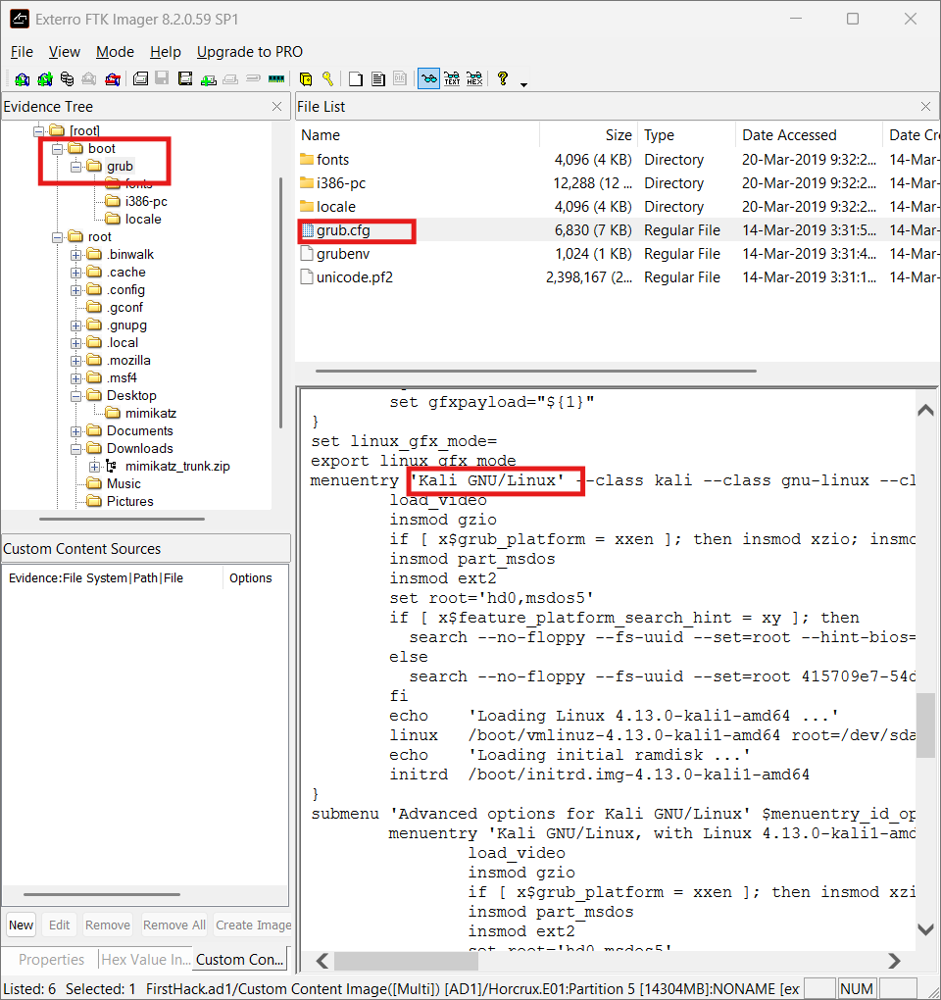

**Portée.** Une machine Kali est une distribution orientée tests d'intrusion : c'est un premier indice sur l'usage du poste.

---

### Q2 — Hachage MD5 du fichier `access.log` d'Apache

**Méthode.** Localisation du fichier dans `/var/log/apache2/`, puis export de sa liste de hachages depuis FTK Imager (CSV ouvert dans Excel).

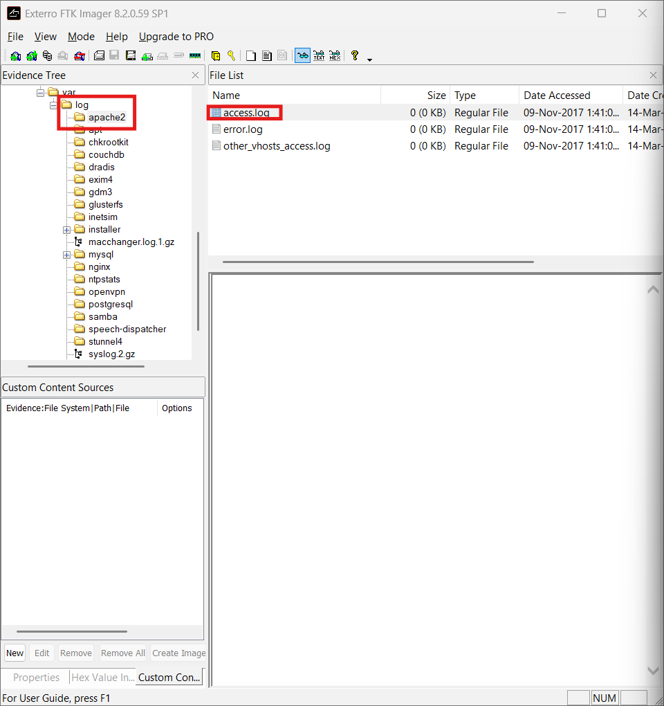

**Constat.** MD5 : `d41d8cd98f00b204e9800998ecf8427e`. SHA1 : `da39a3ee5e6…` (début visible sur la capture).

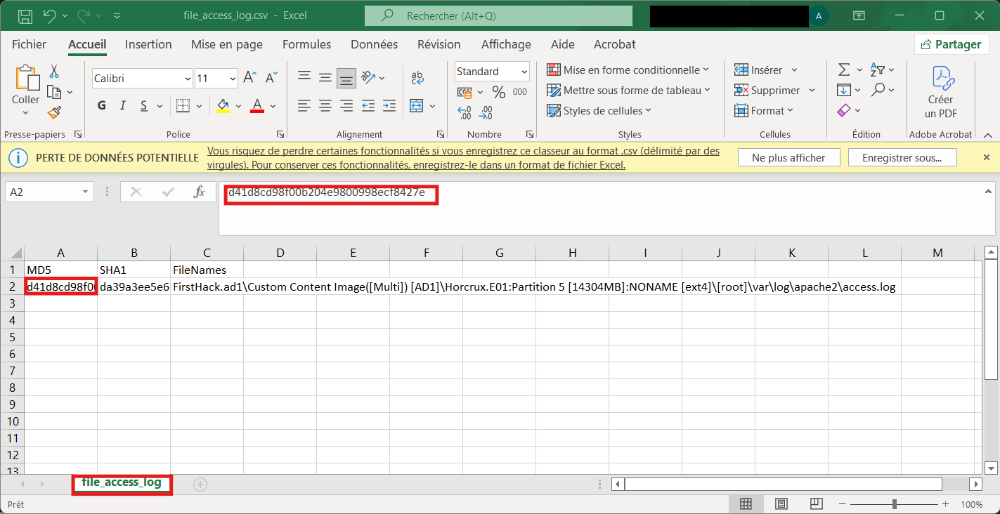

**Analyse.** Cette valeur est le hachage MD5 bien connu d'un **fichier de 0 octet**. Elle est cohérente avec la taille de 0 Ko observée dans FTK Imager et renforce la conclusion de la question 7.

---

### Q3 — Outil de vol d'identifiants téléchargé

**Méthode.** Exploration du dossier de téléchargements de l'utilisateur root.

**Constat.** `/root/Downloads/` contient l'archive **`mimikatz_trunk.zip`**. Un dossier `mimikatz` est également présent sur le Bureau (`/root/Desktop/mimikatz`), ce qui suggère que l'archive a été **décompressée**.

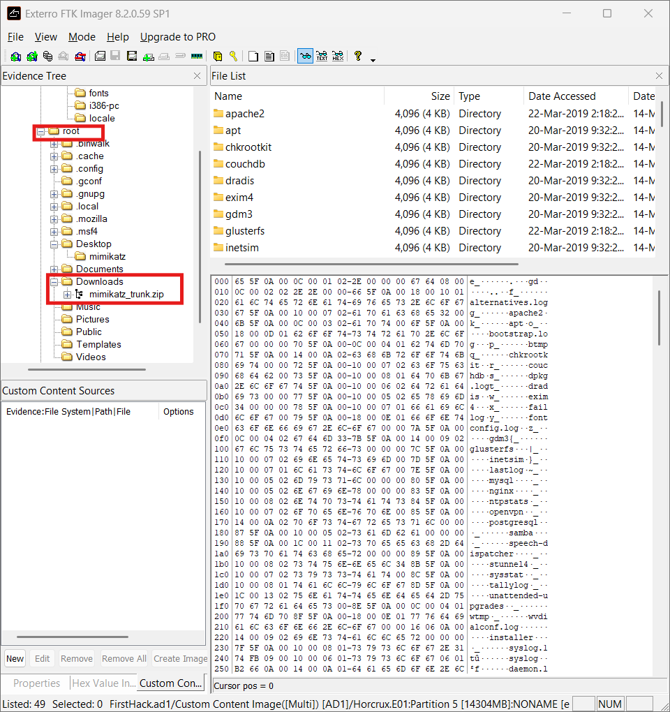

**Analyse.** Mimikatz est l'outil de référence pour extraire des mots de passe et des condensats depuis la mémoire d'un système Windows. Sa présence indique une intention de récupérer des identifiants (par exemple ceux de Bob, cf. Q6 et Q8). L'image ne permet toutefois pas de prouver qu'il a été **exécuté**.

---

### Q4 — Fichier « ultra secret »

**Méthode.** Recherche du fichier `.bash_history` (`find ./ -name .bash_history`), puis lecture avec `cat`.

**Constat.** L'historique contient :

```
touch snky snky > /root/Desktop/SuperSecretFile.txt
cat snky snky > /root/Desktop/SuperSecretFile.txt
```

Le fichier créé est donc **`/root/Desktop/SuperSecretFile.txt`**. Un fichier vide `snky` (0 Ko) présent dans `/root` corrobore ces commandes.

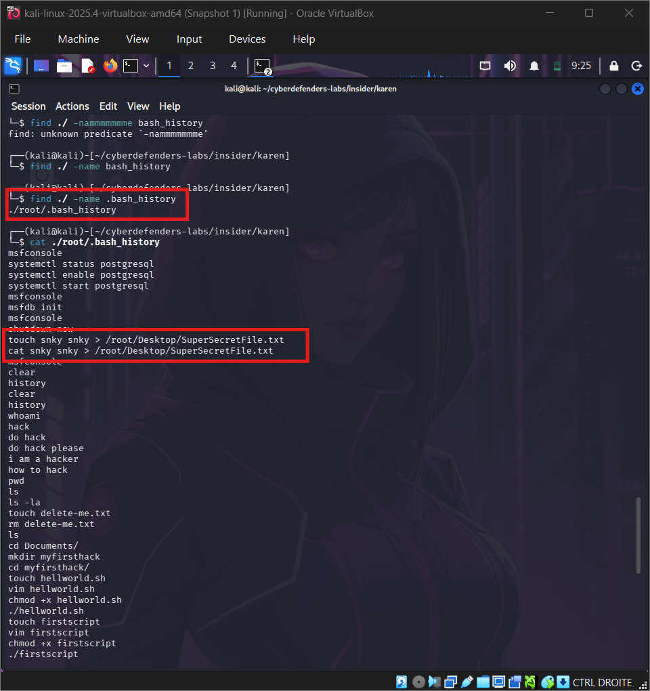

**Analyse.** Les commandes `touch` et `cat` redirigées vers le Bureau créent le fichier ; l'historique ne renseigne pas sur son contenu. Le chemin absolu suffit à répondre à la question.

---

### Q5 — Programme utilisant `didyouthinkwedmakeiteasy.jpg`

**Constat.** L'historique contient la commande :

```
binwalk didyouthinkwedmakeiteasy.jpg
```

Le programme est **`binwalk`**. Le fichier image se trouve dans `/root/Documents/myfirsthack/` et un répertoire `.binwalk` existe dans `/root`.

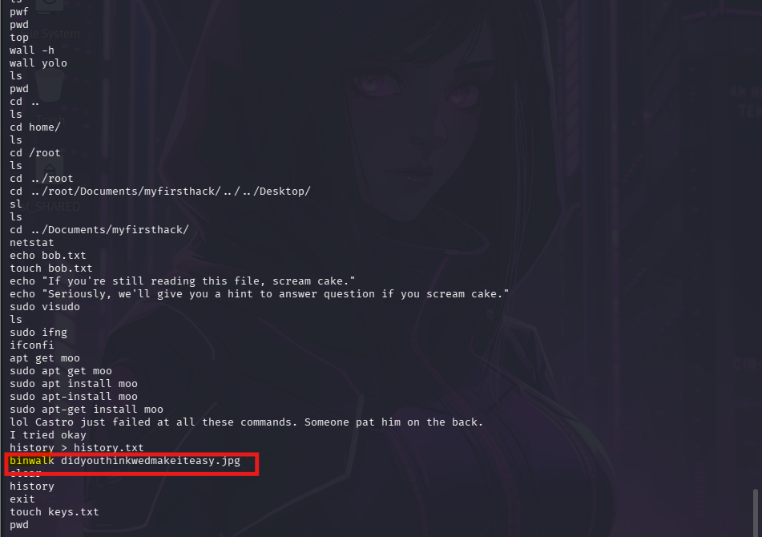

**Analyse.** `binwalk` sert à détecter des données ou fichiers **embarqués** dans un autre fichier (stéganographie, firmware). Karen examinait donc probablement le contenu caché de l'image, comme dans un défi de type CTF.

---

### Q6 — Troisième objectif de la checklist

**Constat.** Le fichier `/root/Desktop/Checklist` contient :

```
Check List:

- Gain Bob's Trust
- Learn how to hack
- Profit
```

Le troisième objectif est **`Profit`**.

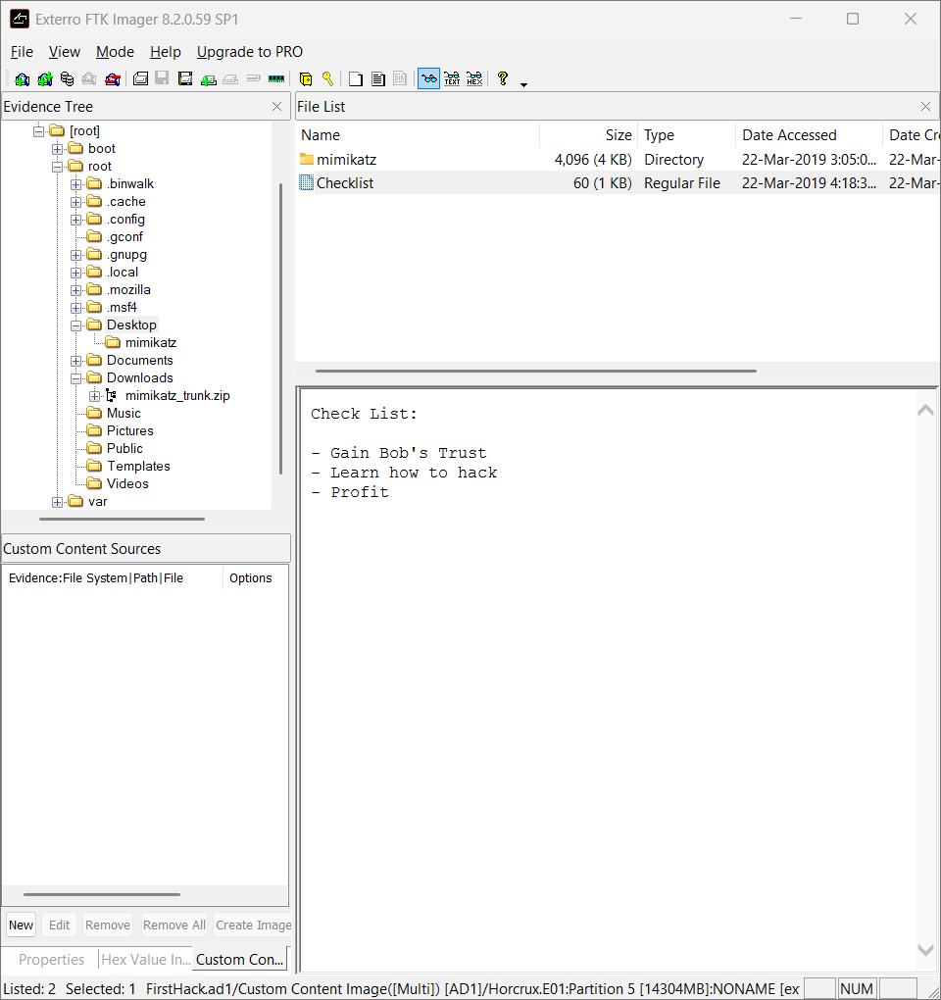

**Analyse.** La liste exprime une **intention** : gagner la confiance de Bob, apprendre à pirater, en tirer profit. Combinée à Mimikatz (Q3) et à la capture du poste de Bob (Q8), elle oriente l'enquête vers Bob comme cible.

---

### Q7 — Nombre d'exécutions d'Apache

**Constat.** Les trois journaux Apache (`access.log`, `error.log`, `other_vhosts_access.log`) font **0 Ko**, et leur contenu hexadécimal est vide.

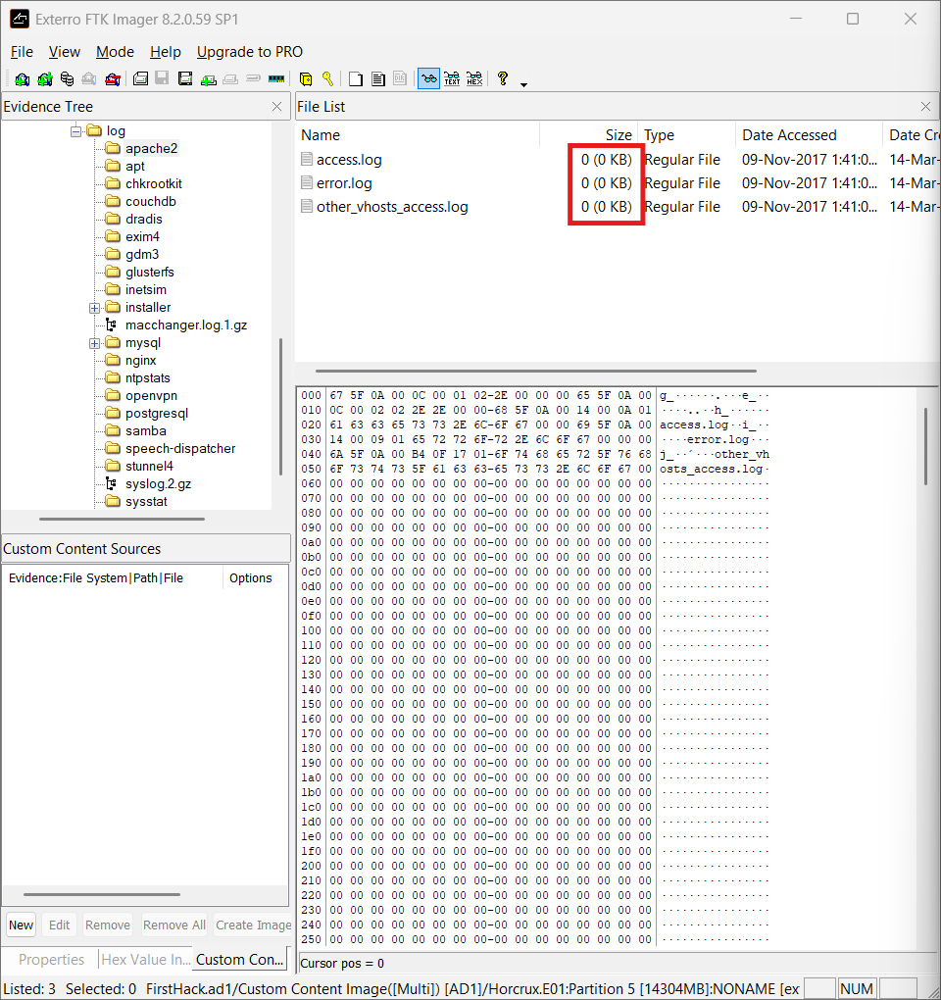

**Conclusion.** Aucun démarrage, requête ni erreur n'a été enregistré : Apache a été exécuté **0 fois**.

**Réserve.** Des journaux vides sont un indice fort, pas une preuve absolue (une rotation ou un nettoyage pourrait en être la cause). La conclusion se renforce en recoupant avec `.bash_history`, où aucune commande de démarrage d'Apache ne devrait apparaître.

---

### Q8 — Preuve de l'attaque d'une autre machine

**Constat.** Le répertoire `/root` contient un fichier image **`irZLAohL.jpeg`** (≈ 130 Ko). Il s'agit d'une **capture d'écran d'un poste Windows** : on y voit un `cmd.exe` lancé en administrateur dans `C:\Users\Bob\AppData\Local\Temp`, exécutant un outil se présentant comme *AlphaSOC Network Flight Simulator*, c'est-à-dire un générateur de trafic réseau malveillant.

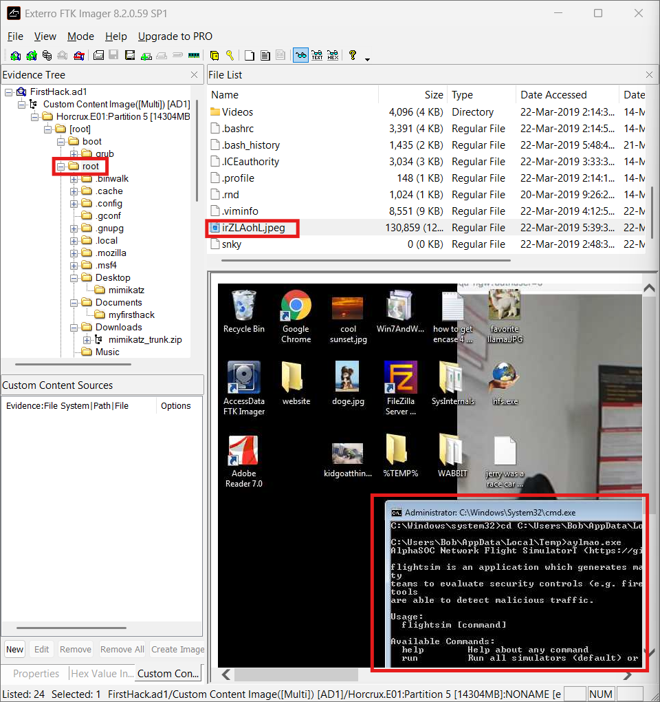

**Analyse.** Cette capture provient d'un **autre ordinateur** (le profil utilisateur est celui de *Bob*) et se retrouve sur la machine de Karen. C'est la preuve que la machine a été utilisée contre un tiers.

**Hypothèse (non prouvée par l'image).** Le nom aléatoire du fichier, la présence de `.msf4` et l'usage de `msfconsole` dans l'historique sont compatibles avec une capture réalisée par une session **Meterpreter** (commande `screenshot`). Cette piste devrait être confirmée sur le poste de Bob.

---

### Q9 — Expert provoqué dans un script

**Constat.** Le script `/root/Documents/myfirsthack/firstscript_fixed` contient :

```bash
echo "Showing you your current path"
pwd
echo "Show my default route"
ip route | grep --color default
echo "Show network connections w/ port 80"
netstat | grep --color 80
echo "Heck yeah! I can write bash too Young"
```

L'expert visé est **`Young`**.

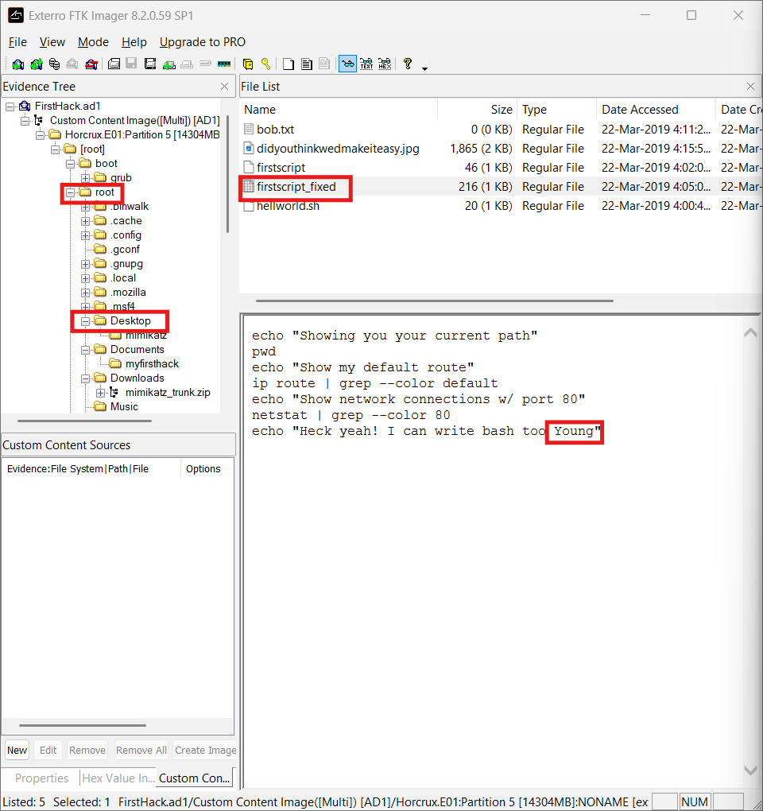

**Analyse.** Le script enchaîne trois commandes de **reconnaissance** (chemin courant, route par défaut, connexions sur le port 80), puis un message de défi adressé à *Young*.

---

### Q10 — Utilisateur concerné par les `su` de 11:26

**Méthode.** Recherche de l'heure dans le journal d'authentification : `grep "11:26" var/log/auth.log`.

**Constat.** Le 20 mars à **11:26:22–11:26:23**, six exécutions successives de `su` (PID 4060, 4074, 4081, 4094, 4101, 4114) sur l'hôte `KarenHacker`. Chaque entrée indique `Successful su for postgres by root`.

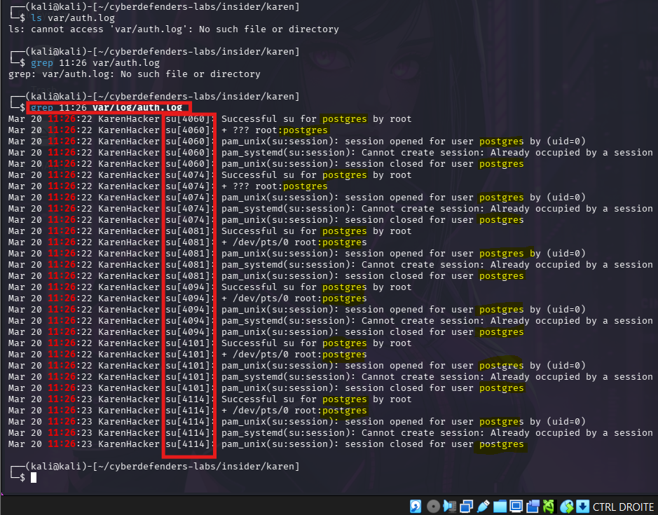

**Réponse.** Le compte ciblé est **`postgres`**, appelé depuis le compte root.

**Analyse.** La cadence (six appels en environ une seconde) indique un **processus automatisé** et non une saisie manuelle. C'est cohérent avec les commandes `systemctl start postgresql` et `msfdb init` de l'historique : l'initialisation de la base de données de Metasploit utilise le compte `postgres`. Ces `su` correspondent donc très probablement à la mise en place de Metasploit, et non à une élévation de privilèges malveillante.

---

### Q11 — Répertoire de travail d'après l'historique

**Méthode.** Résolution des chemins relatifs des dernières commandes `cd`.

```
cd /root
cd ../root
cd ../root/Documents/myfirsthack/../../Desktop/    →  /root/Desktop
cd ../Documents/myfirsthack/                       →  /root/Documents/myfirsthack
```

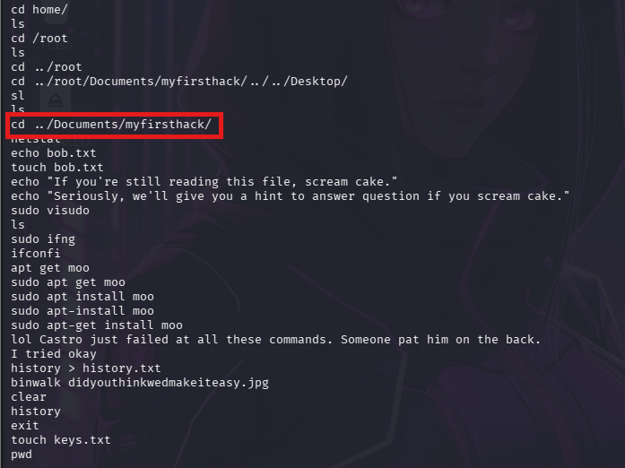

**Réponse.** **`/root/Documents/myfirsthack`**.

**Réserve.** Après `exit`, l'historique contient encore `touch keys.txt` et `pwd`. Ces lignes appartiennent vraisemblablement à une **autre session** : leur répertoire courant ne peut pas être déduit avec certitude.

## 7. Chronologie reconstituée

L'historique `bash` ne contient pas d'horodatage. L'ordre ci-dessous est celui des commandes ; les dates proviennent des journaux et des dates d'accès (*Date Accessed*) affichées par FTK Imager, qui indiquent un **accès** et non une création.

| Phase | Éléments observés | Source |
|---|---|---|
| **1. Mise en place de Metasploit** | `systemctl start postgresql`, `msfdb init`, `msfconsole`, puis `shutdown now` | `.bash_history` |
| **2. Fichier secret** | Création de `SuperSecretFile.txt` sur le Bureau | `.bash_history` |
| **3. Apprentissage** | `whoami`, `hack`, `how to hack`, création du dossier `myfirsthack`, scripts `hellworld.sh`, `firstscript` | `.bash_history` |
| **20 mars, 11:26** | Six `su` root → `postgres` (initialisation de la base Metasploit, probablement) | `auth.log` |
| **22 mars, ≈ 04:00–04:18** | Accès aux scripts, à `bob.txt`, à `didyouthinkwedmakeiteasy.jpg` et à la `Checklist` | FTK Imager (dates d'accès) |
| **4. Reconnaissance et défi** | `netstat`, `ifconfig`, `ip route`, message à *Young*, fichier `bob.txt` | `.bash_history`, script |
| **22 mars, ≈ 05:39** | Accès à la capture `irZLAohL.jpeg` (poste de Bob) | FTK Imager |
| **5. Analyse et fin de session** | `binwalk` sur l'image, `history > history.txt`, `clear`, `history`, `exit` | `.bash_history` |
| **22 mars, ≈ 05:48** | Dernier accès à `.bash_history` | FTK Imager |

## 8. Indicateurs de compromission et artefacts clés

| Type | Valeur | Remarque |
|---|---|---|
| Nom d'hôte | `KarenHacker` | Visible dans `auth.log` |
| Fichier | `/root/Downloads/mimikatz_trunk.zip` | Outil de vol d'identifiants |
| Répertoire | `/root/Desktop/mimikatz` | Extraction probable de l'archive |
| Fichier | `/root/Desktop/SuperSecretFile.txt` | Fichier créé par commande |
| Fichier | `/root/Desktop/Checklist` | Objectifs : *Gain Bob's Trust*, *Learn how to hack*, *Profit* |
| Fichier | `/root/irZLAohL.jpeg` | Capture du poste de Bob |
| Fichier | `/root/Documents/myfirsthack/firstscript_fixed` | Script de reconnaissance et de défi |
| Fichier | `/root/Documents/myfirsthack/didyouthinkwedmakeiteasy.jpg` | Analysé avec `binwalk` |
| Répertoires | `/root/.msf4`, `/root/.binwalk` | Traces d'utilisation de Metasploit et de binwalk |
| Hachage | MD5 `d41d8cd98f00b204e9800998ecf8427e` | `access.log` (fichier vide) |
| Compte | `postgres` | Cible des `su` du 20 mars à 11:26 |
| Personnes citées | `Bob` (cible), `Young` (expert provoqué) | Scénario du lab |

## 9. Correspondance MITRE ATT&CK

| Constat | Tactique | Technique |
|---|---|---|
| Téléchargement de Mimikatz et usage de Metasploit | Resource Development | **T1588.002** — Obtain Capabilities: Tool |
| Intention de récupérer des identifiants (Mimikatz présent, exécution non prouvée) | Credential Access | **T1003** — OS Credential Dumping *(potentielle)* |
| Commandes exécutées dans un shell Bash | Execution | **T1059.004** — Unix Shell |
| `ifconfig`, `ip route` | Discovery | **T1016** — System Network Configuration Discovery |
| `netstat` | Discovery | **T1049** — System Network Connections Discovery |
| Capture du bureau de Bob | Collection | **T1113** — Screen Capture *(hypothèse, cf. Q8)* |

## 10. Limites de l'analyse

- **Image partielle.** Seuls `/boot`, `/var/log` et `/root` ont été acquis : `/home`, `/etc`, `/tmp` et le reste du système sont hors périmètre.
- **Exécution de Mimikatz non démontrée.** Sa présence prouve la possession de l'outil, pas son usage.
- **Horodatages.** L'historique `bash` n'est pas daté ; les dates FTK sont des dates d'**accès** et peuvent être modifiées par la simple consultation.
- **Q7.** L'absence de journaux Apache est un indice fort, à croiser avec les autres sources.
- **Q8.** L'origine exacte de la capture d'écran (Meterpreter ou autre) est une hypothèse.
- **Scénario fictif.** Les personnes citées sont des personnages du lab.

## 11. Recommandations

Dans un contexte réel de menace interne, ces mesures auraient permis de détecter ou limiter les faits observés :

1. **Contrôle applicatif et EDR** : bloquer ou alerter sur Mimikatz, Metasploit et leurs artefacts.
2. **Centralisation des journaux** : envoyer `auth.log` et les journaux système vers un SIEM, avec conservation hors de la machine.
3. **Horodatage de l'historique shell** : activer `HISTTIMEFORMAT` et la journalisation des commandes (`auditd`).
4. **Détection des `su` et élévations de privilèges** : alertes sur les rafales d'authentifications.
5. **Surveillance réseau** : détecter les flux inhabituels vers les postes sensibles et les téléchargements d'outils offensifs.
6. **Principe du moindre privilège** : éviter l'usage permanent du compte root.
7. **Sensibilisation et contrôle des comptes internes** : politique d'usage des outils de sécurité, revue des accès.

## 12. Conclusion

L'enquête établit que la machine de Karen est une station Kali Linux sur laquelle ont été réunis des outils offensifs (Mimikatz, Metasploit, binwalk), une liste d'objectifs visant Bob, et une capture d'écran du poste de ce dernier. L'historique des commandes montre une personne en phase d'**apprentissage** (scripts de débutant, essais ratés d'installation) mais avec une **intention** explicite, ce qui justifie un examen approfondi du poste de Bob et des accès de Karen aux ressources de l'entreprise.

Ce lab m'a permis de pratiquer l'acquisition logique, la vérification d'intégrité, l'analyse d'artefacts Linux (`grub.cfg`, `.bash_history`, `auth.log`), la corrélation de sources et la rédaction d'un rapport distinguant faits prouvés et hypothèses.

## 13. Annexe : reproduire l'analyse

```bash
# 1. Intégrité des fichiers téléchargés
sha256sum 64-Insider.zip FirstHack.ad1
md5sum 64-Insider.zip FirstHack.ad1

# 2. Se placer dans les fichiers exportés depuis FTK Imager (lecture seule)
cd ~/cyberdefenders-labs/insider/karen && chmod -R a-w .

# Q1 — distribution
grep -i "menuentry" boot/grub/grub.cfg | head

# Q2 — hachage de access.log
md5sum var/log/apache2/access.log
ls -la var/log/apache2/

# Q3 — téléchargements
ls -la root/Downloads/

# Q4, Q5, Q11 — historique des commandes
find ./ -name ".bash_history"
cat -n root/.bash_history

# Q6 — checklist
cat root/Desktop/Checklist

# Q8 — fichiers image dans /root
ls -la root/ | grep -i -E "jpe?g|png"

# Q9 — scripts du répertoire Documents
cat root/Documents/myfirsthack/firstscript_fixed

# Q10 — su à 11:26
grep "11:26" var/log/auth.log
```

**Structure du dépôt**

```
.
├── README.md
└── screenshots/
    ├── q01_grub_cfg_kali.png
    ├── q02_apache2_access_log.png
    ├── q02_md5_access_log.png
    ├── q03_downloads_mimikatz_zip.png
    ├── q04_bash_history_supersecretfile.png
    ├── q05_bash_history_binwalk.png
    ├── q06_checklist_et_bureau.png
    ├── q07_logs_apache_0ko.png
    ├── q08_irZLAohL_jpeg.png
    ├── q09_firstscript_fixed.png
    ├── q10_auth_log_su_1126.png
    └── q11_dernier_cd.png
```

---

*Rapport rédigé à des fins pédagogiques à partir d'un lab CyberDefenders. Les noms, entreprises et événements sont ceux d'un scénario fictif.*
